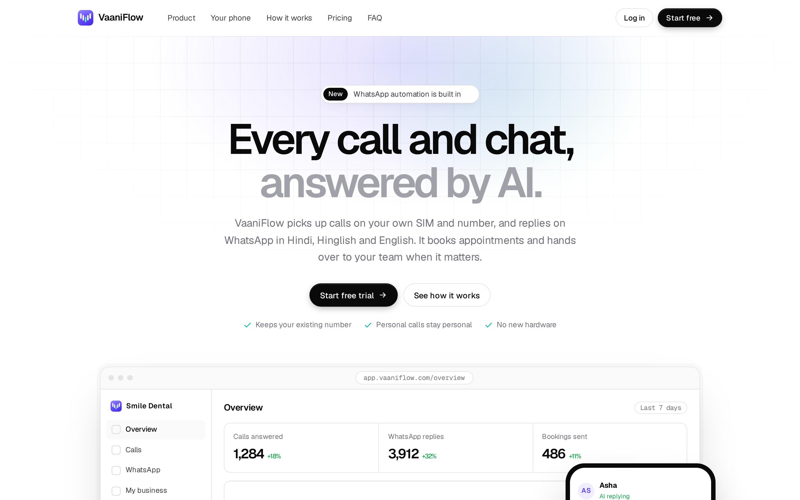
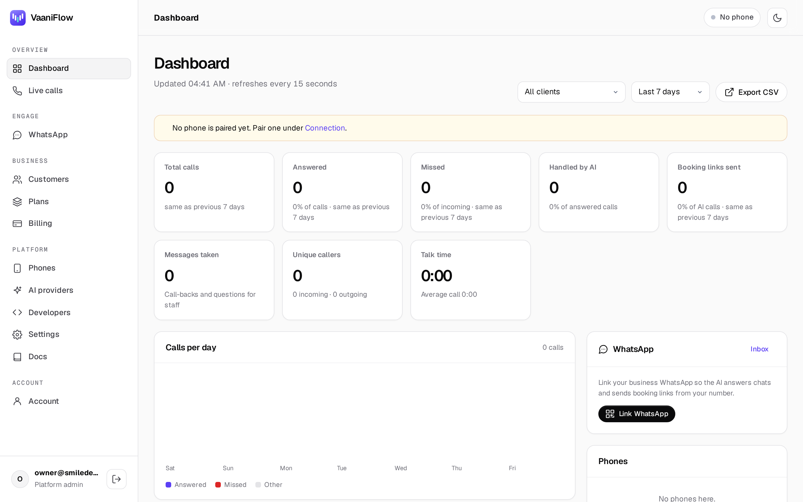
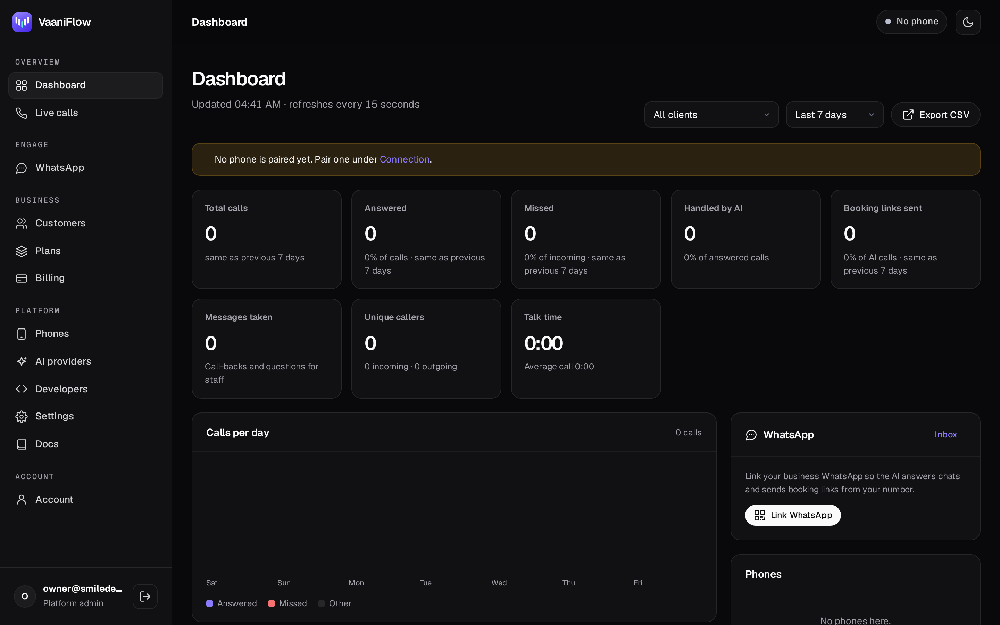
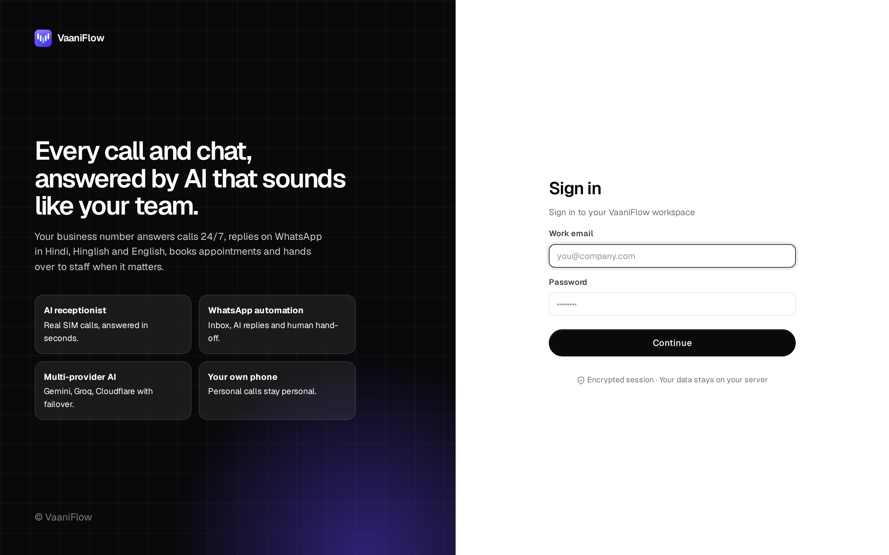
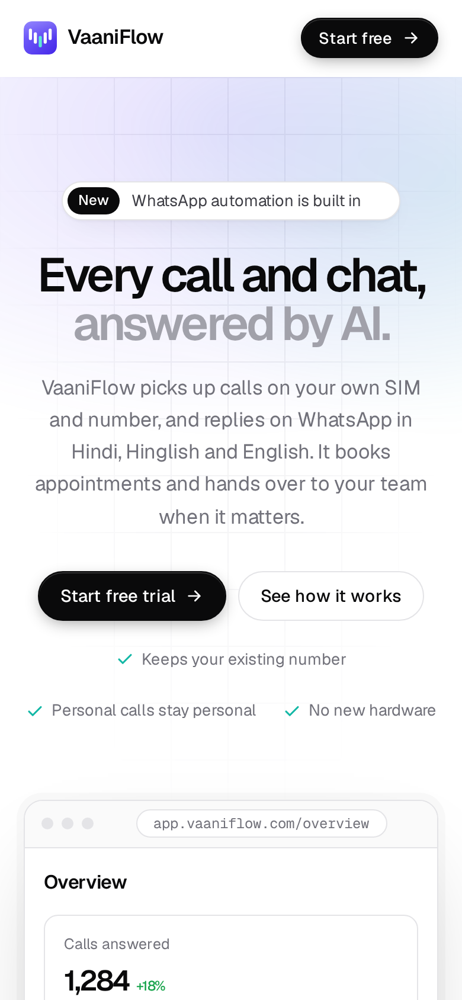
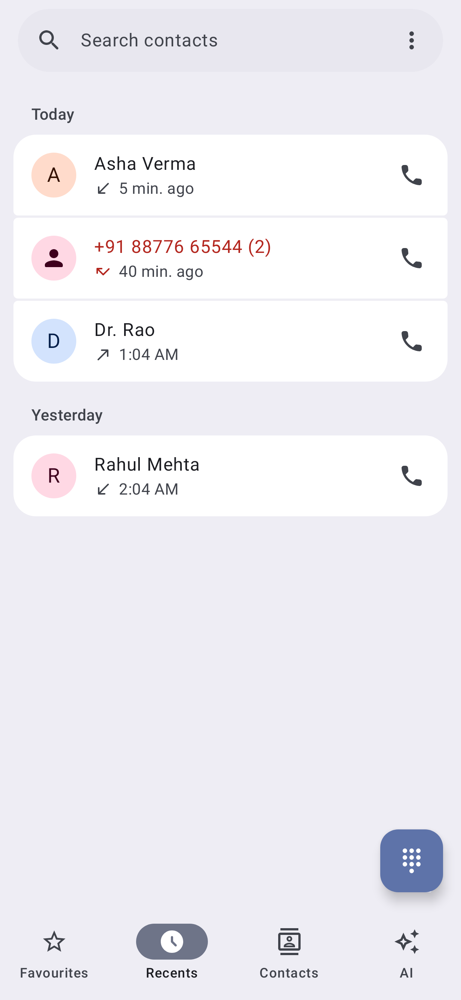
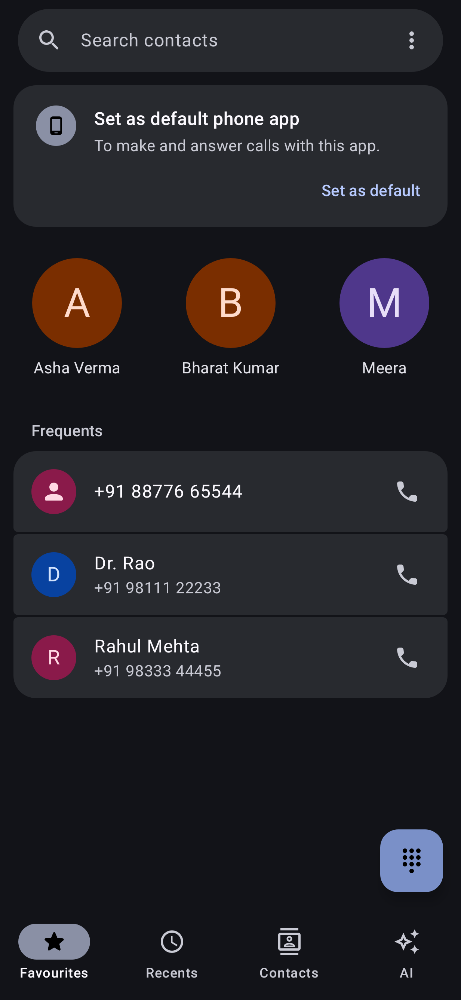
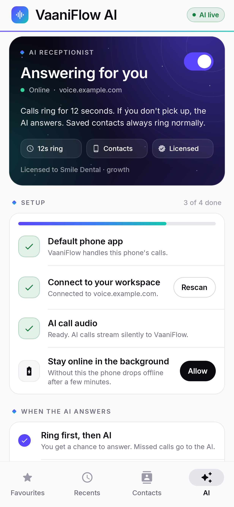
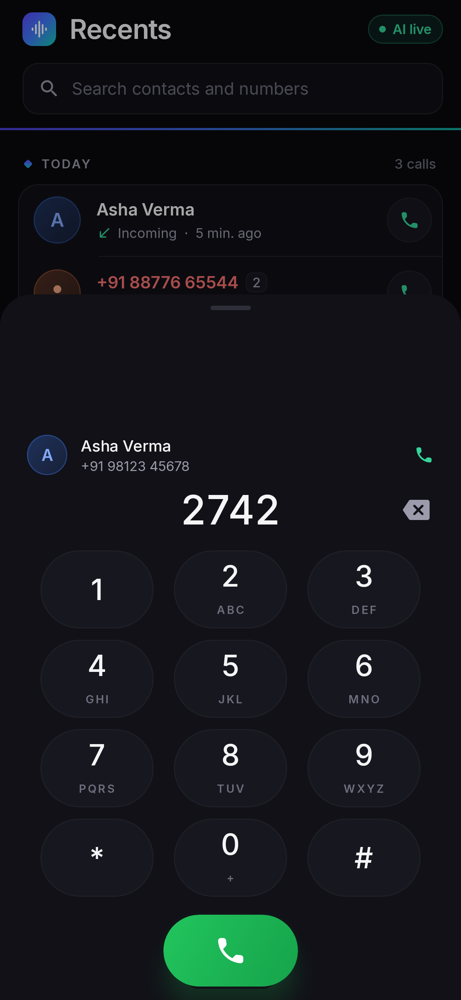

<p align="center"></p>

<h1 align="center">VaaniFlow</h1>

<p align="center"><b>AI receptionist for business calls and WhatsApp.</b><br>
Real SIM calls answered by AI, WhatsApp chats answered by AI, one dashboard for your team.</p>

<p align="center"></p>

| Dashboard | Dashboard (dark) |
|---|---|
|  |  |
| **Sign in** | **Website on mobile** |
|  |  |

| Phone app: Recents | Favourites (dark) | VaaniFlow AI tab | Keypad (dark) |
|---|---|---|---|
|  |  |  |  |

---

VaaniFlow is a self-hosted SaaS platform. An Android phone with the business SIM runs the VaaniFlow
phone app; the server answers its calls with an AI voice agent, replies to the business's WhatsApp
messages, sends booking links, and hands conversations to staff when needed.

## What's inside

| Part | What it does |
|---|---|
| **Website** (`/`) | Product landing page with live pricing from your plans. |
| **Dashboard** (`/console`) | Admin: customers, plans, billing, phones, AI providers, live calls, developers. Customer: overview, WhatsApp inbox, business info, phones, plan & billing. Light and dark mode, mobile friendly. |
| **WhatsApp automation** | Each business links its own number by QR (Linked devices). AI replies from the business info in Hindi, Hinglish or English, human hand-off, per-chat AI pause, staff replies from the inbox or phone, quick replies, fallback message, booking links after calls. |
| **AI providers** | Gemini Live for calls; Gemini, Groq, Cloudflare Workers AI, OpenRouter, Cerebras, Mistral, Sarvam or any OpenAI-compatible API for chat and the speech pipeline. Automatic failover and a **Test** button per key. |
| **Phone app** (`android/`) | A full dialer like the Google Phone app: favourites, recents, contacts, T9 keypad, call screen (mute, speaker, Bluetooth, hold, add call, swap, merge, dual SIM), incoming call notifications and missed calls. The **VaaniFlow AI** tab decides when the AI may answer. |
| **Voice API** | Place, answer and control calls over REST, signed webhooks, stream call audio to your own agents over WebSockets (raw PCM or Twilio Media Streams). |
| **SaaS** | Customers, plans, licences, minutes, Razorpay billing, audit log. See [SAAS.md](SAAS.md). |

## Personal calls stay personal

The phone app is the default phone app, so the owner can keep using their own phone:

- **Ring first, then AI**: the phone rings for N seconds; if nobody answers, the AI picks up silently.
- **Saved contacts always ring normally** and never reach the AI (checked on the phone, contacts never leave it).
- **SIM the AI handles**: on dual-SIM phones the personal SIM rings normally.
- **Business hours**: outside them the AI answers instantly.
- **Let AI answer / Take over** buttons on the call screen, and **Turn AI off** in the notification.

The phone sends its decision with each incoming call (`"ai": "now" | "after:<s>" | "never"`) and
the server follows it.

## Run it

**Docker (any VPS, Azure VM, AWS EC2/Lightsail)**

```bash
cp deploy/docker/.env.example deploy/docker/.env    # set DOMAIN and HTTP_GATEWAY_API_KEY
docker compose -f deploy/docker/docker-compose.yml --env-file deploy/docker/.env up -d --build
```

Caddy provisions HTTPS for your domain. Open `https://<domain>/console` and create the admin account.

**Node.js 22.13+**

```bash
cd server
cp .env.example .env          # set HTTP_GATEWAY_API_KEY to a long random string
npm install && npm run build && npm start
```

Step-by-step guides (Hindi/Hinglish): [DEPLOYMENT.md](DEPLOYMENT.md) ·
[CLIENT_DELIVERY.md](CLIENT_DELIVERY.md) · [SAAS.md](SAAS.md).

## Phone app

GitHub → Actions → **Android APK** → Run workflow, or build locally:

```bash
cd android && ./gradlew :app:assembleDebug        # app/build/outputs/apk/debug/app-debug.apk
./gradlew :app:testDebugUnitTest -Droborazzi.test.record=true   # screenshots of the screens
```

Install it on an Android 10+ phone with the SIM, set it as the phone app, then scan the pairing QR
from **Phones** in the dashboard. Details: [android/README.md](android/README.md).

## Repository

| Folder | Contents |
|---|---|
| [`server/`](server/) | Node.js + TypeScript server: REST API, WebSockets, WhatsApp (Baileys), AI routing, dashboard and website, SQLite |
| [`android/`](android/) | VaaniFlow phone app (Kotlin, Jetpack Compose) |
| [`deploy/`](deploy/) | Docker Compose + Caddy, and VM scripts for per-client deployments |
| [`docs-site/`](docs-site/) | API documentation site (Astro Starlight) |
| [`simulator/`](simulator/) | Mock phone and example agents for development |

## Responsible use

You're responsible for the calls and messages you send. Follow local laws on automated calls,
telling people they're talking to an AI, recording consent and WhatsApp's terms. The WhatsApp link
is an unofficial linked-device client; avoid bulk or unsolicited messaging.

## License

MIT. VaaniFlow builds on the open-source OpenLine project; see [LICENSE](LICENSE).
